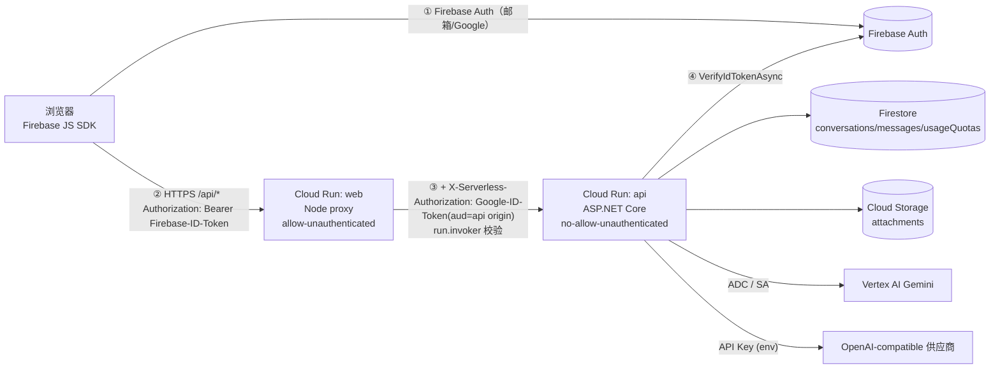

# 架构审查：球球布丁工作室

审查日期：2026-10-16　分支：`claude`　范围：仓库代码、Dockerfile、CI/CD、部署脚本（未访问任何真实 GCP 环境）

> 证据等级：**[V]** 已由仓库代码验证　**[C]** 已确认存在问题　**[R]** 合理风险推断　**[U]** 云端配置，尚未验证

## 1. 实际技术栈（以代码为准）

| 层 | 实现 | 证据 |
|---|---|---|
| 浏览器 | 原生 ES Module（`app.js`≈1250 行 + `markdown/sse/attachments/thinking.js`），Firebase JS SDK 11.10.0 经 gstatic CDN 动态 import | `apps/web/public/app.js:232` |
| Web 服务 | Node 24 `http` 服务：静态资源 + `/api/*` 反向代理，用 metadata server 取 ID Token 写入 `X-Serverless-Authorization` | `apps/web/server.mjs` |
| API | .NET 10 Minimal API，Serilog，Firebase Admin 3.5.0，Firestore 4.3.0，Storage 4.13.0，**Google.GenAI 0.14.0** | `VertexAI/VertexAI.csproj` |
| 模型 | Gemini（Vertex AI，location=`global`）+ 6 家 OpenAI-compatible（DeepSeek/Kimi/Qwen/智谱/OpenRouter/MiMo，自写 HttpClient + SSE 解析） | `appsettings.json`, `OpenAICompatibleChatModelClient.cs` |
| 数据 | Firestore：`conversations`、`messages`、`usageQuotas`；附件在 GCS（`chat-attachments/{conv}/{msg}/{idx}`） | `FirestoreConversationStore.cs` |
| 部署 | GitHub Actions + WIF → `gcloud builds submit` → `gcloud run deploy`（两个服务） | `.github/workflows/deploy-cloud-run.yml` |

## 2. 请求链路与认证边界

两个**独立**的信任边界：
- **边界 A（用户）**：Firebase ID Token，由 API 在每个端点校验（`FirebaseUserContext.cs:32`）。**[V]** 所有会话/消息/导出/删除/标题端点都先取用户并以 `uid` 字段做所有权校验（`FirestoreConversationSchema.OwnsConversation`）。
- **边界 B（服务）**：Cloud Run IAM `roles/run.invoker`。web 服务对公网开放，所以**任何互联网请求都能经 web 代理到达 API 的所有路径**；API 的保护完全依赖边界 A。边界 B 只防"绕过 web 直连 API"。

| 链路 | 认证 | 外部依赖 | 数据 |
|---|---|---|---|
| 登录 | Firebase | Firebase Auth | 无服务端存储 |
| `GET /api/workspace/config` | **无**（公开） | — | 返回模型目录 + Firebase Web 配置（本就公开） |
| `POST /api/chat/stream` | A+B | Vertex/第三方、Firestore、GCS | 写 user/model 消息、附件、配额 |
| `/api/conversations*`, `/api/export*` | A+B | Firestore、GCS | 读写本人数据 |
| `/api/admin/quotas/daily` | A（`admin` custom claim）+B | Firestore | 读全站用量 |

## 3. 架构评估

**Node 反向代理是否必要？** 当前实现只做三件事：静态文件、转发、签发 ID Token。API 本身已强制 Firebase Token，因此"私有后端"提供的是**纵深防御**而非主要防线。代理自身缺少取消传播、超时对齐、背压（见 F-02/F-03/F-25）。

**方案对比**

| | 方案 1：保留双服务并加固 | 方案 2：合并为单个 Cloud Run 服务（ASP.NET 托管静态文件） |
|---|---|---|
| 做法 | 修超时/取消/Secret/探针；代理加 AbortSignal 与限速 | `UseStaticFiles` 托管 `apps/web/public`，删除 Node 服务、IAM invoker、metadata token 逻辑 |
| 安全 | 多一层 IAM（对公网无增益，因 web 本身公开） | 攻击面等同现状（现状已是公网可达所有 API 路径）；少一套服务间认证配置错误面 |
| 可靠性 | 两跳，每跳都要对齐超时/取消 | 一跳，取消与超时天然一致；SSE 少一个缓冲点 |
| 成本 | 两个服务、两套镜像；冷启动叠加 | 一个服务；min-instances=0 时只一次冷启动 |
| 工作量 | 小（2–3 天） | 中（3–5 天），需回归前端路径与缓存头 |
| 风险 | 低 | 低–中；回滚=保留旧 web 服务一个版本周期 |
| **推荐** | 短期（Phase 1）先做 | **Phase 2 推荐迁移**：个人/小规模下，单服务更简单、更便宜、故障面更小 |

不推荐 Firebase Hosting rewrite 到 Cloud Run：Hosting 对 Cloud Run 重写有请求时长上限，SSE 长生成存在被截断风险 **[U：以官方文档为准，本环境无法访问 docs.cloud.google.com]**。不推荐引入 API Gateway/Load Balancer + Cloud Armor：对个人规模成本（LB 约每月 $18+）与复杂度不成比例，先以预算告警 + App 层限额替代。

**C# 后端职责**：合理（鉴权、配额、编排、模型适配、持久化）。`ChatOrchestrator` 把"配额→会话→历史→增强→流式→持久化→结算"串在一个方法里，职责偏重但行数可控（249 行），不需要拆分框架，只需补取消令牌与结算语义。

**过度封装/重复**：
- `GeminiService` 同时承担会话状态、历史裁剪、摘要、配置构建（600 行）并且是 *scoped 有状态对象*，每请求 `new Client(...)`（`GeminiService.cs:64`）。服务端本就每次从 Firestore 重载历史，状态对象的价值有限。
- `ChatHistoryManager` 每次请求至少 1 次 `CountTokens` 往返，超限时再做 1 次摘要生成（额外费用与延迟）。摘要结果**不持久化**（`HistorySummary` 字段存在但未写入）。
- `AuthRateLimiter` 无任何引用（死代码）；`ApiUserContext` 是一行透传封装；`IChatModelClient` 与 `GeminiService` 有大量遗留重载（`StreamChatAsync(List<Part>)` 等）。
- 模型目录 JSON 内置 6 家供应商的 `Thinking.Kind` 字符串，通过 `switch` 在客户端内映射——这是可接受的轻量适配层（见 D 节），无需另建框架。

**单点/瓶颈**：Firestore 单区域（**[U]**）；限速为进程内内存，随实例数线性放大；`max-instances`=10×`concurrency`=20 才是真正的全站并发/费用上限。

## 4. 值得保留的设计
- 应用层所有权校验一致且简单（以 `uid` 字段 + 随机 GUID 文档 ID）；未发现跨用户读/写/删路径。
- Firebase Admin 验签（不自写 JWT 逻辑）；管理员来自服务端 custom claim，不信任浏览器标志。
- WIF 部署，无长期服务账号密钥；API `--no-allow-unauthenticated`；部署后做"直连应返回 403"的烟测。
- 附件走 GCS + 自定义最小权限角色，Firestore 只存元数据。
- 前端 Markdown 采用 DOM 构建渲染（无 `innerHTML`），已有单测；SSE 解析独立成模块并有测试。
- 配额服务使用 Firestore 事务做"检查并预留"，方向正确（实现缺陷见 F-05）。
- ETag/`no-cache` 静态资源策略、`firestore.indexes.json` 与部署脚本。

## 5. 验证限制
无 `dotnet` SDK（下载被代理拦截），未能编译/运行 C# 测试；无 GCP 凭据，无法读取 IAM、Firestore 规则、Billing、Cloud Run 实际配置；`docs.cloud.google.com` 域名在本环境无法解析，官方文档结论部分来自搜索摘要，已逐条标注。
